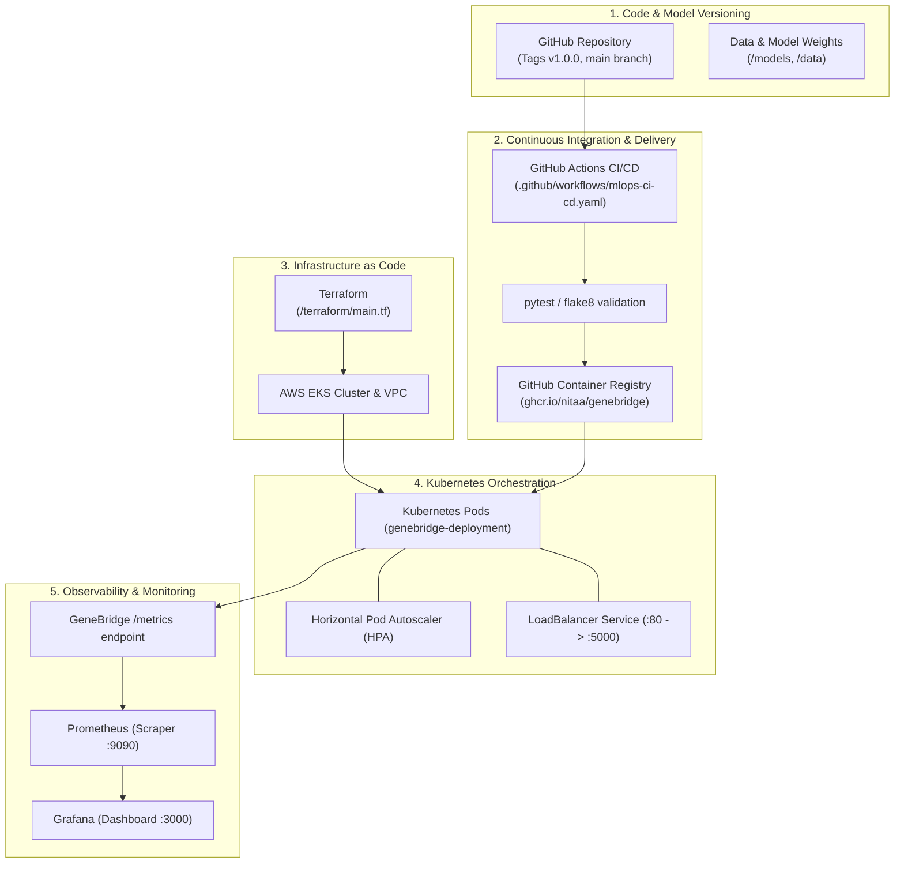

# GeneBridge MLOps Architecture & Operations Guide

This document details the production MLOps architecture implemented for **GeneBridge**, covering versioning, automated CI/CD pipelines, containerization, Kubernetes orchestration, Infrastructure as Code via Terraform, and metrics monitoring with Prometheus & Grafana.

---

## 1. Architecture Overview



---

## 2. GitHub Versioning & Model Tracking

### Semantic Versioning
GeneBridge follows [Semantic Versioning 2.0.0](https://semver.org/):
* `MAJOR` (`v1.0.0`): Fundamental architectural change or schema redesign.
* `MINOR` (`v1.1.0`): New model added (e.g., neural network) or new cross-species dataset incorporated.
* `PATCH` (`v1.0.1`): Bug fixes, latency optimizations, prompt/filtering tweaks.

### How to Release a New Version
To publish an official version tag for your guide:
```bash
# 1. Commit all your latest changes
git add .
git commit -m "feat(mlops): implement end-to-end MLOps pipeline"

# 2. Tag the release
git tag -a v1.0.0 -m "GeneBridge MLOps Release v1.0.0"

# 3. Push commit and tag to GitHub
git push origin main
git push origin v1.0.0
```
Pushing a tag matching `v*` will trigger the GitHub Actions workflow to build and tag the Docker image with `v1.0.0`.

---

## 3. GitHub Actions CI/CD Pipeline

Located at `.github/workflows/mlops-ci-cd.yaml`:
1. **Lint & Code Quality (`flake8`)**: Ensures code follows Python formatting guidelines and contains no syntax errors.
2. **Model & Observability Tests (`pytest`)**: Runs `tests/test_metrics.py` to ensure `/api/health`, `/metrics`, and `/api/predict` respond accurately.
3. **Container Build & Registry Push**: Builds the production Docker image and publishes it to `ghcr.io`.
4. **K8s Manifest Verification**: Validates `k8s/kustomization.yaml` syntax.

---

## 4. Docker Containerization

### Standalone Build & Run
```bash
# Build image
docker build -t genebridge:v1.0.0 .

# Run container
docker run -d -p 5000:5000 --name genebridge genebridge:v1.0.0
```

### Full Local MLOps Stack (App + Prometheus + Grafana)
```bash
docker compose up --build
```
* **GeneBridge**: http://localhost:5000
* **Prometheus**: http://localhost:9090
* **Grafana**: http://localhost:3000 (Credentials: `admin` / `admin`)

---

## 5. Kubernetes Orchestration (`k8s/`)

The Kubernetes stack is structured with production-grade declarative manifests:
* `namespace.yaml`: Isolated `genebridge-mlops` namespace.
* `configmap.yaml`: Application runtime parameters.
* `deployment.yaml`: Replicas with rolling updates, resource limits (`cpu: 250m-1000m`, `memory: 512Mi-1.5Gi`), and health probes (`/api/health`).
* `service.yaml`: LoadBalancer service routing HTTP traffic to port 5000.
* `hpa.yaml`: Horizontal Pod Autoscaler scaling pods from 2 to 8 when CPU utilization exceeds 70%.

### Deploying to Kubernetes:
```bash
kubectl apply -k k8s/

# Verify resources
kubectl get pods -n genebridge-mlops
kubectl get svc -n genebridge-mlops
kubectl get hpa -n genebridge-mlops
```

---

## 6. Infrastructure as Code (Terraform)

Located in `terraform/`:
* `versions.tf`: Configures AWS provider (~> 5.0).
* `variables.tf`: Configurable parameters (region, node size, scaling boundaries).
* `main.tf`: Creates VPC, subnets, NAT gateway, IAM roles, EKS Cluster, and managed worker node group.
* `outputs.tf`: Outputs cluster endpoint and `kubectl update-kubeconfig` command.

### Provisioning Infrastructure:
```bash
cd terraform
terraform init
terraform plan
terraform apply
```

---

## 7. Metrics & Observability (Prometheus & Grafana)

The Flask app exposes real-time inference metrics on `/metrics`:
* **`genebridge_predictions_total`**: Counter measuring inference volume broken down by condition, severity, and outcome status.
* **`genebridge_inference_duration_seconds`**: Histogram tracking inference duration (P50, P95, P99).
* **`genebridge_model_accuracy_ratio`**: Gauge exposing the accuracy scores of the underlying ensemble models.
* **`genebridge_api_requests_total`**: Counter tracking all incoming HTTP requests.

### Live Demo Simulation:
Run the simulated traffic generator to visualize live graph fluctuations in Grafana:
```bash
python scripts/simulate_traffic.py
```

